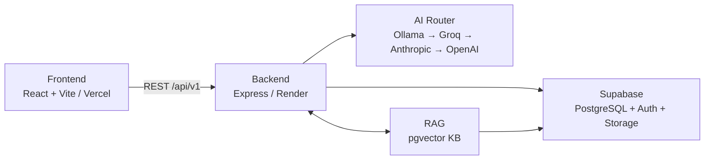
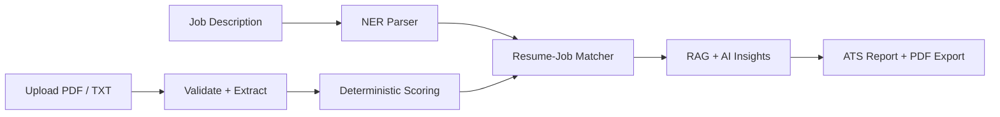

<div align="center">

# ReworkCV

**AI-Powered Resume Intelligence & ATS Optimization Platform**

[](https://reworkcv-kappa.vercel.app)
[](https://reworkcv-2.onrender.com/api/v1/health)
[](https://nodejs.org)
[](https://www.typescriptlang.org)

*Paste your resume. Paste a job description. Get a grounded, ATS-ready analysis and a tailored cover letter in seconds.*

[**Live App**](https://reworkcv-kappa.vercel.app) · [**API Health**](https://reworkcv-2.onrender.com/api/v1/health) · [**Architecture**](./docs/architecture.md) · [**Deployment**](./docs/deployment.md)

</div>

---

## Overview

ReworkCV is a full-stack SaaS platform that transforms a resume and a job description into structured ATS-readiness intelligence. It combines a deterministic multi-section scoring engine, a RAG knowledge base, and a multi-provider LLM router to deliver evidence-grounded gap analysis, actionable recommendations, and ready-to-submit cover letters.

**Local-first:** Ollama is the primary AI provider. Groq, Anthropic, and OpenAI are optional cloud fallbacks. The core scoring never requires a cloud key.

---

## Tech Stack

| Layer | Technologies |
|---|---|
| **Frontend** | React 19, Vite 6, TypeScript, Tailwind CSS 3, Framer Motion, React Router DOM 7, `@supabase/supabase-js` |
| **Backend** | Node.js ≥ 20, Express 4, TypeScript, Zod, Multer, `pdf-parse`, `pdfkit`, `docx`, Pino, Helmet, `express-rate-limit` |
| **Database / Auth** | Supabase (PostgreSQL + RLS + Storage), `pgvector`, Supabase Auth |
| **AI / NLP** | Ollama, Groq SDK, Anthropic SDK, OpenAI SDK, `@huggingface/transformers`, Deterministic NER |
| **Tooling** | Vitest, ESLint, Prettier, Docker, Vercel (frontend), Render (backend) |

---

## Architecture





---

## Key Features

- Deterministic section scoring — Summary 15%, Skills 20%, Experience 25%, Education 15%, Projects 15%, Certifications 10%
- Job-description matching — required skills 70%, preferred 20%, section alignment 10%
- RAG-augmented insights via `pgvector` hybrid retrieval
- Multi-provider AI router with automatic failover
- AI Coach Chat for conversational follow-up
- Cover letter generation with PDF and DOCX export
- Full scan history — every analysis stored and reopenable

---

## Local Setup

**Prerequisites:** Node.js ≥ 20, a [Supabase](https://supabase.com) project, and optionally [Ollama](https://ollama.com).

```bash
# 1. Clone and install
git clone https://github.com/its-sudharshan-45/ReworkCV.git
cd ReworkCV
npm install

# 2. Configure environment
cp backend/.env.example backend/.env        # fill in Supabase keys + optional AI keys
cp frontend/.env.example frontend/.env.local # fill in VITE_ keys + VITE_API_URL

# 3. Apply database migrations (run in order 001 → 025)
for f in database/migrations/*.sql; do psql "$DATABASE_URL" -f "$f"; done

# 4. Start development servers
npm run dev           # both frontend + backend
npm run dev:backend   # API only  → http://localhost:4000
npm run dev:frontend  # UI only   → http://localhost:5173
```

---

## Environment Variables

| Variable | Side | Required | Description |
|---|---|---|---|
| `SUPABASE_URL` | Backend | Yes | Supabase project URL |
| `SUPABASE_ANON_KEY` | Backend | Yes | Supabase anon key |
| `SUPABASE_SERVICE_ROLE_KEY` | Backend | Yes | **Server-side only — never expose** |
| `CORS_ORIGIN` | Backend | Prod | Comma-separated `https://` frontend origins |
| `GROQ_API_KEY` / `ANTHROPIC_API_KEY` / `OPENAI_API_KEY` | Backend | No | Cloud AI fallbacks |
| `LOCAL_AI_BASE_URL` | Backend | No | Ollama URL (default `http://localhost:11434`) |
| `RAG_ADMIN_API_KEY` | Backend | No | ≥ 32-char key; unset = admin endpoints return `403` |
| `VITE_SUPABASE_URL` | Frontend | Yes | Same Supabase URL |
| `VITE_SUPABASE_ANON_KEY` | Frontend | Yes | Supabase anon key (safe to publish) |
| `VITE_API_URL` | Frontend | Yes | Backend URL + `/api/v1` |

Full list with defaults: [`.env.example`](./.env.example)

---

## Scripts

```bash
npm run dev           # Start frontend + backend
npm run build         # Production build
npm run test          # Vitest suites
npm run typecheck     # TypeScript check
npm run lint          # ESLint
npm run format        # Prettier
npm run rag:seed --workspace=backend   # Seed RAG knowledge base
```

---

## Deployment

### Backend — Docker / Render

```bash
cp backend/.env.example backend/.env   # set NODE_ENV=production, CORS_ORIGIN, Supabase keys
docker compose up --build -d
curl http://localhost:4000/api/v1/health   # verify
```

> Run exactly one replica — the upload semaphore and RAG cache are in-process.

### Frontend — Vercel

Set Vercel **Root Directory** to the repository root. Add `VITE_SUPABASE_URL`, `VITE_SUPABASE_ANON_KEY`, `VITE_API_URL` as environment variables. In Supabase **Auth → URL Configuration**, add your frontend origin and `https://<domain>/auth/callback` as the redirect URL.

---

## API Overview

Base: `/api/v1` · Auth: `Authorization: Bearer <jwt>`

| Resource | Key Endpoints |
|---|---|
| Health | `GET /health` |
| Profile | `GET /profile` · `PATCH /profile` |
| Resumes | `POST /resumes` · `GET /resumes/:id` · `POST /resumes/:id/process` · `POST /resumes/:id/analyze-job` · `GET /resumes/:id/report/pdf` · `DELETE /resumes/:id` |
| Job Analyses | `GET /resumes/:id/job-analyses` · `GET /resumes/:id/job-analyses/latest` |
| Cover Letters | `POST /cover-letters` · `GET/PATCH/DELETE /cover-letters/:id` · `POST /cover-letters/:id/rewrite` · `GET /cover-letters/:id/export/:format` |
| AI Coach | `POST /ai-coach/chat` |
| RAG | `POST /rag/search` · `POST /rag/analyze` · `POST /rag/ingest` *(admin)* |

**Upload constraints:** PDF and TXT only (magic-byte verified), max 5 MB. Job description: 10–20,000 chars.

---

## Contributing

```bash
git checkout -b feature/name
npm run typecheck && npm run lint && npm run test
# open pull request
```

- Never commit `backend/.env` or `frontend/.env.local`
- New schema changes → new numbered migration file; never edit an applied migration
